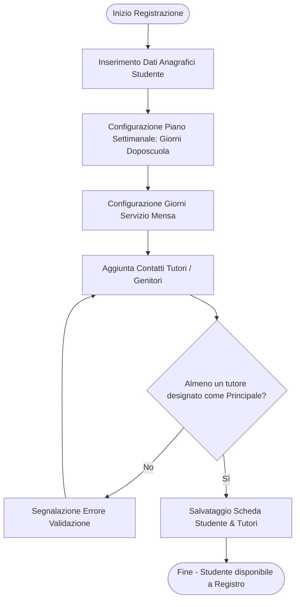
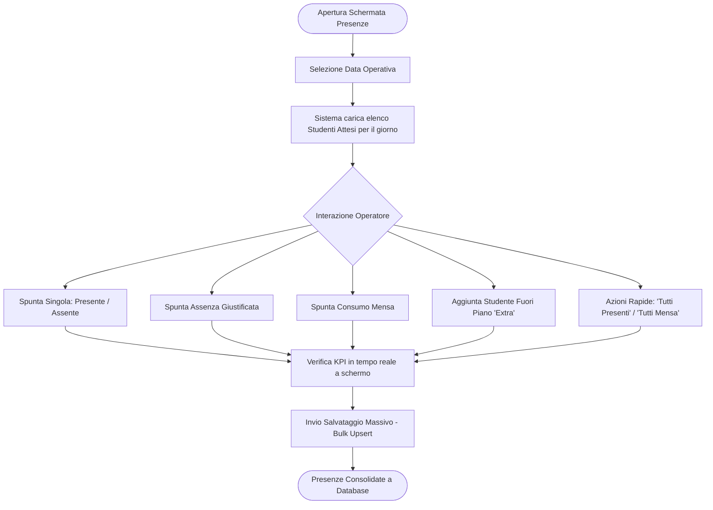
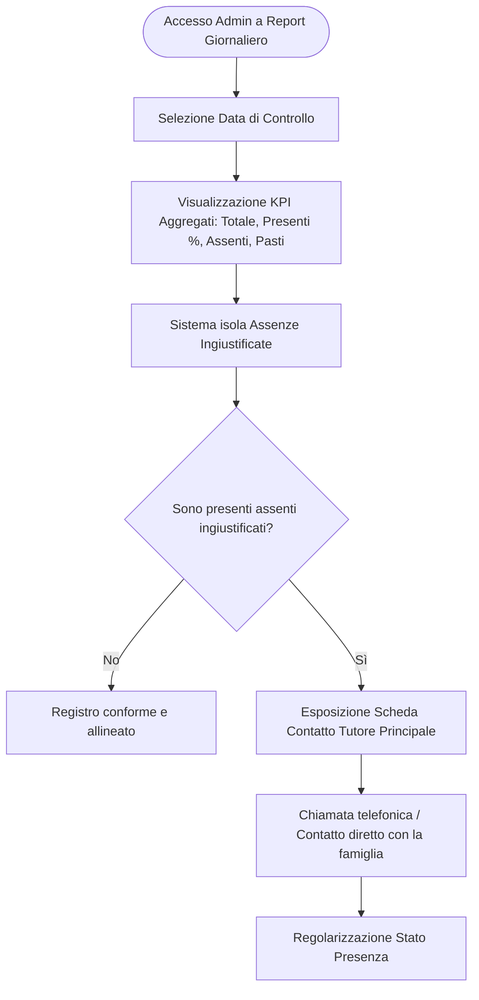
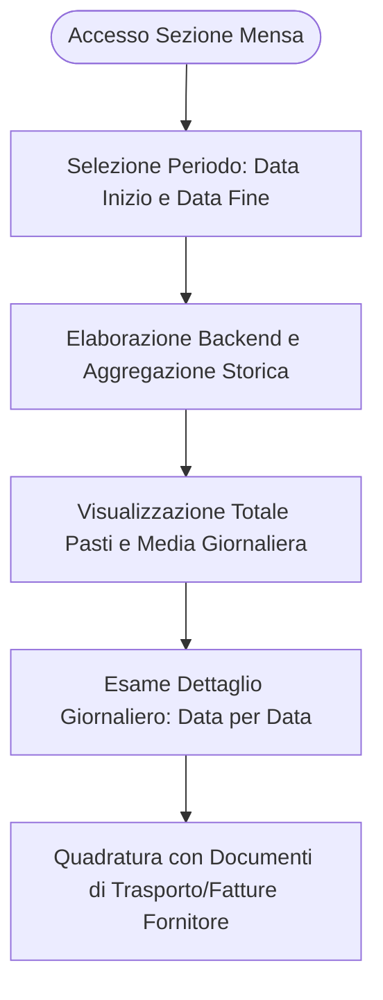

# Analisi Funzionale: Processi Operativi dell'Applicazione Primola

Il presente documento descrive le **funzionalità e le capacità a livello di processo di business** dell'ecosistema software **Primola**, evidenziando gli attori coinvolti, i flussi operativi, le regole di validazione e il trattamento dei dati.

---

## 1. Mappa dei Ruoli e Attori di Processo

L'accesso alle funzioni e la visibilità dei dati sono regolati da un modello **Role-Based Access Control (RBAC)** a due livelli:

| Ruolo | Responsabilità nel Processo | Permessi Chiave |
|---|---|---|
| **Operatore Staff** | Rilevazione presenze sul campo, accoglienza studenti, inserimento nuove schede anagrafiche. | - Segnare presenze e pasti del giorno. - Aggiungere studenti extra fuori abbonamento. - Registrare nuovi studenti e tutori. - Consultare la rubrica iscritti. |
| **Amministratore (Admin)** | Supervisione globale del doposcuola, quadratura amministrativa dei servizi mensa, gestione sicurezza e contatti con le famiglie per assenze ingiustificate. | - Tutti i permessi dello Staff. - Accesso esclusivo alla Reportistica Giornaliera. - Accesso al Rendiconto Mensa per intervallo temporale. - Visualizzazione e gestione assenze ingiustificate. |

---

## 2. Processo 1: Gestione Anagrafica Studenti e Famiglie

### Obiettivo del Processo
Censire uno studente nel doposcuola, definire i giorni di frequenza concordati con la famiglia, le preferenze per il servizio mensa e i contatti di emergenza dei genitori/tutori.

### Dettaglio dei Passi Operativi
1. **Dati Anagrafici Base**:
   - Nome, cognome, data di nascita, luogo di nascita, indirizzo di residenza e istituto scolastico di provenienza.
2. **Definizione Abbonamento & Servizi**:
   - Assegnazione dei giorni della settimana di frequenza (Lunedì, Martedì, Mercoledì, Giovedì, Venerdì).
   - Assegnazione separata dei giorni in cui lo studente fruisce della mensa.
   - *Nota architetturale*: Tali array (`SMALLINT[]`) consentono al sistema di calcolare automaticamente gli "studenti attesi" per ciascun giorno lavorativo.
3. **Gestione Dinamica Tutori**:
   - Possibilità di registrare uno o più tutori per studente (madre, padre, nonni, delegati).
   - Per ciascun tutore: nome, cognome, numero di telefono, email e note operative (es. orari di reperibilità).
   - **Regola di validazione**: Obbligo di designare almeno un tutore come referente principale (`is_main_contact` / `is_main = true`).

---

## 3. Processo 2: Gestione Operativa Presenze Giornaliere (Check-in & Mensa)

### Obiettivo del Processo
Tracciare in tempo reale l'arrivo degli studenti nella struttura, registrare l'eventuale consumo del pasto e identificare assenze o ingressi non pianificati.

### Capacità Operative del Flusso:
- **Calcolo Dinamico degli Attesi**: Selezionando una data nel calendario, il sistema interroga il database verificando l'indice del giorno settimanale (`EXTRACT(ISODOW FROM date)`) e propone automaticamente l'elenco dei soli studenti attesi per quel giorno.
- **Supporto Presenze "Extra"**: Se uno studente si presenta in una giornata non inclusa nel suo abbonamento, l'operatore può selezionarlo dalla rubrica e aggiungerlo alla griglia del giorno come `is_extra = true`. Questa informazione è fondamentale per il successivo calcolo della tariffazione/conguaglio.
- **Distinzione Tipologia Assenza**:
  - *Assenza semplice*: Lo studente non è arrivato e la famiglia non ha avvisato (diventa un'anomalia).
  - *Assenza giustificata*: La famiglia ha comunicato in anticipo l'assenza (es. malattia o impegno).
- **Rilevazione Pasti (Mensa)**: Possibilità di accendere/spegnere la spunta pasto indipendentemente dalla presenza, calcolando all'istante il totale delle porzioni necessarie.
- **Salvataggio Transazionale / Idempotente**: L'operazione di invio sfrutta un vincolo di unicità `(student_id, date)` a livello DB, garantendo che salvataggi multipli aggiornino lo stato senza creare record duplicati (*upsert*).

---

## 4. Processo 3: Supervisione Amministrativa e Contatto Famiglie

### Obiettivo del Processo
Fornire alla direzione/segreteria il quadro dell'affluenza giornaliera e velocizzare l'accertamento delle assenze impreviste per ragioni di sicurezza dell'alunno.

### Punti Chiave del Processo:
1. **Quadro Direzionale**: Indicatori visivi chiari con tasso percentuale di affluenza rispetto agli iscritti della giornata.
2. **Alert Assenze Non Notificate**: Il sistema filtra automaticamente i record in cui `is_present = false` AND `is_absent_justified = false`.
3. **One-Click Call**: Nella scheda dell'alunno assente compare il nominativo e il numero telefonico del tutore primario, con trigger nativo di chiamata (`tel:+39...`) direttamente da browser o tablet.

---

## 5. Processo 4: Rendicontazione Mensa e Fornitori

### Obiettivo del Processo
Riconciliare il numero effettivo di pasti consumati dagli studenti in un determinato arco temporale per il controllo delle fatture del servizio catering/mensa e per l'addebito alle famiglie.

### Output di Processo:
- **Totale Complessivo**: Numero totale dei pasti consumati nel periodo (es. settimana o mese).
- **Media Pasti/Giorno**: Indicatore di carico medio della cucina.
- **Serie Storica Giornaliera**: Tabella riepilogativa con il conteggio dei pasti erogati giorno per giorno, utile per contestare discrepanze sulle bolle di consegna del fornitore.

---

## 6. Matrice Funzionalità vs Requisiti di Processo

| Requisito di Processo | Stato di Copertura | Componente Responsabile |
|---|---|---|
| Autenticazione operatore e segregazione ruoli | **Completo** | Backend (JWT/RBAC) + Frontend (Guards) |
| Calcolo automatico attesi giornalieri | **Completo** | DB (GIN/SQL) + Backend (`/attendances/expected`) |
| Check-in rapido presenze e pasti | **Completo** | Frontend Dashboard Presenze |
| Gestione alunni extra non schedulati | **Completo** | Frontend (Modal Extra) + DB (`is_extra`) |
| Gestione anagrafica studente e tutori multipli | **Completo** | Frontend (Reactive Form) + DB (Relazione 1:N) |
| Allarmi assenze ingiustificate e contatto rapido | **Completo** | Frontend Admin + Backend (`/reports/attendances`) |
| Rendicontazione pasti per catering | **Completo** | Frontend Admin + Backend (`/reports/mensa`) |
| Modalità offline/fallback di emergenza | **Completo** | Frontend ApiService (Fallback a Mock reattivi) |
