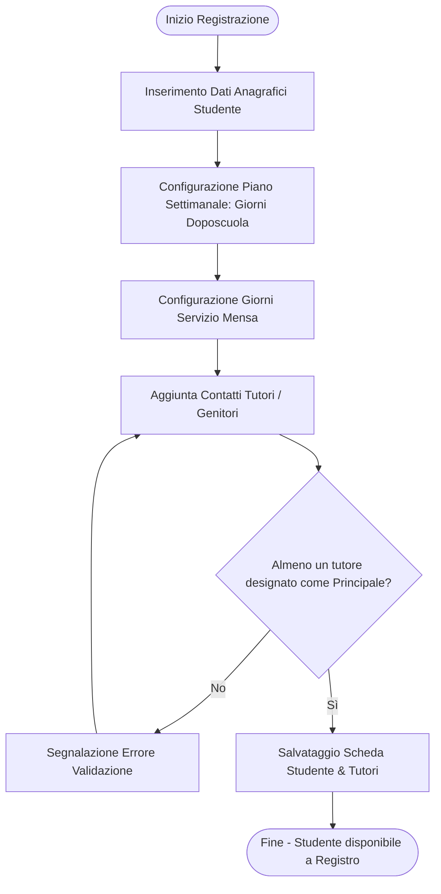
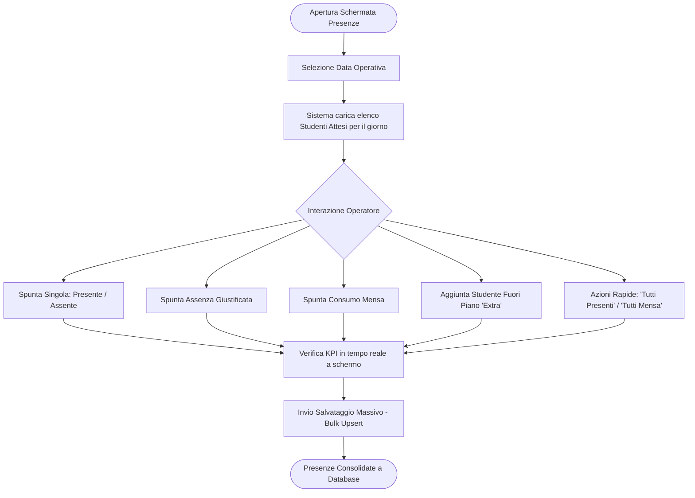
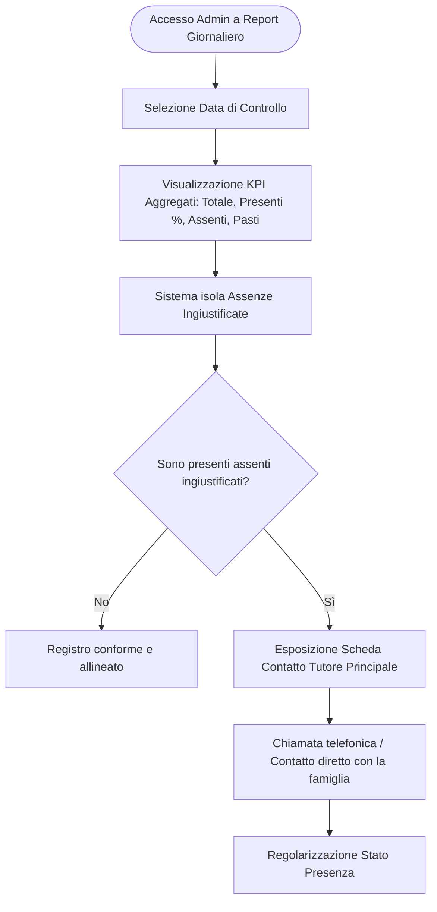
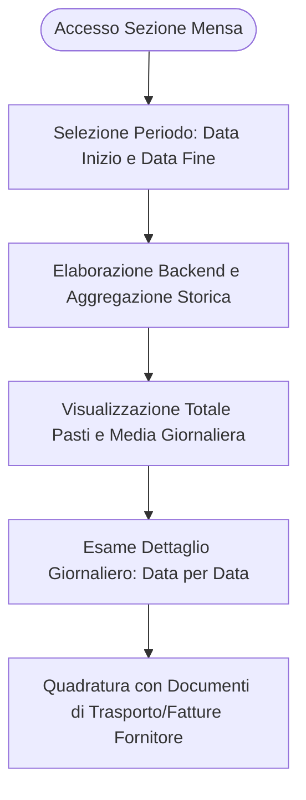
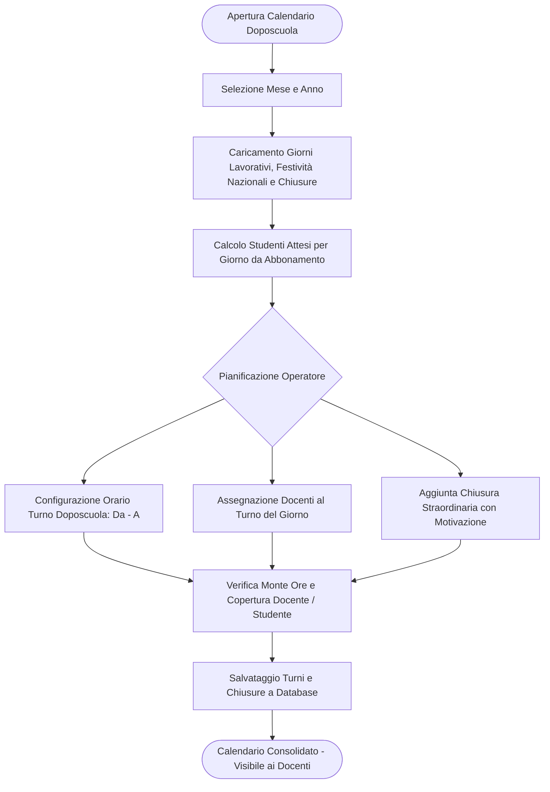
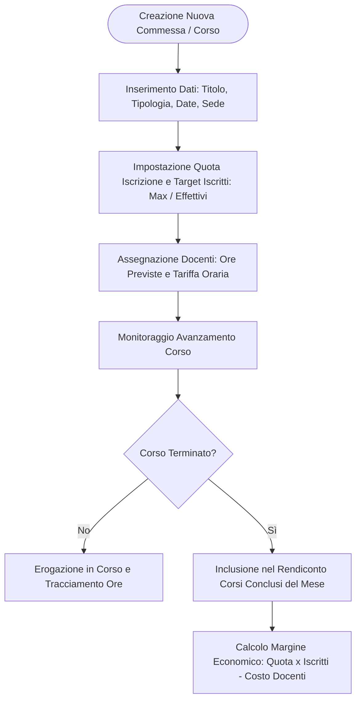

# Analisi Funzionale: Processi Operativi dell'Applicazione Primola

Il presente documento descrive le **funzionalità e le capacità a livello di processo di business** dell'ecosistema software **Primola**, evidenziando gli attori coinvolti, i flussi operativi, le regole di validazione e il trattamento dei dati.

---

## 1. Mappa dei Ruoli e Attori di Processo

L'accesso alle funzioni e la visibilità dei dati sono regolati da un modello **Role-Based Access Control (RBAC)** a quattro livelli:

| Ruolo | Responsabilità nel Processo | Permessi Chiave |
|---|---|---|
| **Operatore Staff / Educator** | Rilevazione presenze sul campo, accoglienza studenti, inserimento nuove schede anagrafiche. | - Segnare presenze e pasti del giorno. - Aggiungere studenti extra fuori abbonamento. - Registrare nuovi studenti e tutori. - Consultare la rubrica iscritti. |
| **Docente (Teacher)** | Conduzione corsi/laboratori specialistici e turni doposcuola assegnati. | - Visualizzare i propri turni doposcuola a calendario. - Consultare i progetti e le ore assegnate. - Nessun accesso ai dati economici globali o tariffe orarie colleghi. |
| **Segreteria (Office)** | Pianificazione operativa, turnazione docenti, gestione commesse/corsi, import massivo e rendicontazione operativa. | - Gestione anagrafiche studenti, import CSV/Excel. - Gestione calendario doposcuola (turni, assegnazione docenti, chiusure straordinarie). - Gestione commesse e corsi extracurricolari. - Accesso ai report operativi mensili e quadratura presenze pagate. |
| **Amministratore (Admin)** | Controllo economico-gestionale, marginalità, report finanziari, configurazione tariffe e gestione utenti/ruoli. | - Tutti i permessi di Office e Staff. - Accesso esclusivo al Report Finanziario Mensile (marginalità, incassi previsti/effettivi, uscite docenti e pasti). - Configurazione parametri economici globali (`system_settings`). - Creazione/modifica utenti, ruoli e tariffe orarie (`hourly_rate`). |

---

## 2. Processo 1: Gestione Anagrafica Studenti e Famiglie

### Obiettivo del Processo
Censire uno studente nel doposcuola, definire i giorni di frequenza concordati con la famiglia, le preferenze per il servizio mensa e i contatti di emergenza dei genitori/tutori.

### Dettaglio dei Passi Operativi
1. **Dati Anagrafici Base**:
   - Nome, cognome, data di nascita, luogo di nascita, indirizzo di residenza e istituto scolastico di provenienza.
2. **Definizione Abbonamento & Servizi**:
   - Assegnazione dei giorni della settimana di frequenza (Lunedì, Martedì, Mercoledì, Giovedì, Venerdì).
   - Assegnazione separata dei giorni in cui lo studente fruisce della mensa.
   - *Nota architetturale*: Tali array (`SMALLINT[]`) consentono al sistema di calcolare automaticamente gli "studenti attesi" per ciascun giorno lavorativo.
3. **Gestione Dinamica Tutori**:
   - Possibilità di registrare uno o più tutori per studente (madre, padre, nonni, delegati).
   - Per ciascun tutore: nome, cognome, numero di telefono, email e note operative (es. orari di reperibilità).
   - **Regola di validazione**: Obbligo di designare almeno un tutore come referente principale (`is_main_contact` / `is_main = true`).

### 2.1 Importazione Massiva Studenti (CSV / XLSX)
Per accelerare l'avvio dell'anno scolastico o il caricamento di grandi elenchi iscritti, l'applicazione supporta il caricamento da file template preformattato (`template_import_studenti.xlsx` o `.csv`):
- **Campi supportati**: Dati anagrafici studente, giorni abbonamento doposcuola (es. `1,2,3,4,5`), giorni mensa, dati anagrafici e recapiti del tutore principale.
- **Validazione preventiva**: Verifica univocità codice fiscale / combinazione anagrafica, parsing formati date e validazione array giorni settimanale (1=Lunedì, 5=Venerdì).
- **Esito operazione**: Notifica a video del numero di schede create con successo ed evidenza di eventuali record scartati con motivazione di errore.

---

## 3. Processo 2: Gestione Operativa Presenze Giornaliere (Check-in & Mensa)

### Obiettivo del Processo
Tracciare in tempo reale l'arrivo degli studenti nella struttura, registrare l'eventuale consumo del pasto e identificare assenze o ingressi non pianificati.

### Capacità Operative del Flusso:
- **Calcolo Dinamico degli Attesi**: Selezionando una data nel calendario, il sistema interroga il database verificando l'indice del giorno settimanale (`EXTRACT(ISODOW FROM date)`) e propone automaticamente l'elenco dei soli studenti attesi per quel giorno.
- **Supporto Presenze "Extra"**: Se uno studente si presenta in una giornata non inclusa nel suo abbonamento, l'operatore può selezionarlo dalla rubrica e aggiungerlo alla griglia del giorno come `is_extra = true`. Questa informazione è fondamentale per il successivo calcolo della tariffazione/conguaglio.
- **Distinzione Tipologia Assenza**:
  - *Assenza semplice*: Lo studente non è arrivato e la famiglia non ha avvisato (diventa un'anomalia).
  - *Assenza giustificata*: La famiglia ha comunicato in anticipo l'assenza (es. malattia o impegno).
- **Rilevazione Pasti (Mensa)**: Possibilità di accendere/spegnere la spunta pasto indipendentemente dalla presenza, calcolando all'istante il totale delle porzioni necessarie.
- **Salvataggio Transazionale / Idempotente**: L'operazione di invio sfrutta un vincolo di unicità `(student_id, date)` a livello DB, garantendo che salvataggi multipli aggiornino lo stato senza creare record duplicati (*upsert*).

---

## 4. Processo 3: Supervisione Amministrativa e Contatto Famiglie

### Obiettivo del Processo
Fornire alla direzione/segreteria il quadro dell'affluenza giornaliera e velocizzare l'accertamento delle assenze impreviste per ragioni di sicurezza dell'alunno.

### Punti Chiave del Processo:
1. **Quadro Direzionale**: Indicatori visivi chiari con tasso percentuale di affluenza rispetto agli iscritti della giornata.
2. **Alert Assenze Non Notificate**: Il sistema filtra automaticamente i record in cui `is_present = false` AND `is_absent_justified = false`.
3. **One-Click Call**: Nella scheda dell'alunno assente compare il nominativo e il numero telefonico del tutore primario, con trigger nativo di chiamata (`tel:+39...`) direttamente da browser o tablet.

---

## 5. Processo 4: Rendicontazione Mensa e Fornitori

### Obiettivo del Processo
Riconciliare il numero effettivo di pasti consumati dagli studenti in un determinato arco temporale per il controllo delle fatture del servizio catering/mensa e per l'addebito alle famiglie.

### Output di Processo:
- **Totale Complessivo**: Numero totale dei pasti consumati nel periodo (es. settimana o mese).
- **Media Pasti/Giorno**: Indicatore di carico medio della cucina.
- **Serie Storica Giornaliera**: Tabella riepilogativa con il conteggio dei pasti erogati giorno per giorno, utile per contestare discrepanze sulle bolle di consegna del fornitore.

---

## 6. Processo 5: Gestione Calendario Doposcuola, Turni Docenti e Chiusure

### Obiettivo del Processo
Pianificare su base mensile e settimanale la copertura del doposcuola, allocando il personale docente sui turni, visualizzando in anteprima il carico studenti attesi per giorno, e programmando giorni festivi e chiusure straordinarie della struttura.

### Punti Chiave del Processo:
1. **Calcolo Carico Bambini per Giornata**:
   - Integrazione istantanea con i giorni di abbonamento attivi (`giorni_abbonamento`), visualizzando il badge del numero di studenti previsti per ogni cella del calendario.
2. **Turnazione e Orari Flessibili**:
   - Definizione orari di inizio e fine turno del doposcuola (es. 13:00 - 17:00), con calcolo ore automatico.
   - Assegnazione multipla di docenti con indicazione delle ore svolte per il calcolo compensi.
3. **Festività e Chiusure Straordinarie**:
   - Riconoscimento automatico delle festività fisse e mobili (es. Pasqua, Lunedì dell'Angelo).
   - Gestione delle chiusure straordinarie (`closure_days`) con esclusione automatica dal conteggio presenze previste e calcoli di fatturazione mensile.

---

## 7. Processo 6: Gestione Commesse, Corsi Extracurricolari e Docenti

### Obiettivo del Processo
Gestire il ciclo di vita delle commesse e dei corsi a catalogo dell'associazione (teatro, lingue, musica, laboratori), monitorando iscritti effettivi, docenti incaricati, ore previste e sostenibilità economica.

### Regole di Business:
- **Tipologia Commessa**: Distinzione tra tipologia `CORSO` e `COMMESSA`.
- **Rapporto Finanziario di Commessa**:
  - Entrata prevista = Quota iscrizione (`enrollment_fee`) × Iscritti effettivi (`actual_enrolled`).
  - Uscita compensi = $\sum (\text{Ore assegnate} \times \text{Tariffa oraria docente})$.
- **Chiusura e Liquidazione**: Al termine del corso (`end_date`), la commessa confluisce nel riepilogo liquidazione compensi docenti.

---

## 8. Processo 7: Configurazione Parametri Economici di Sistema

### Obiettivo del Processo
Consentire all'amministratore di governare centralmente le tariffe applicate per il doposcuola e per il servizio mensa, evitando valori hardcoded nel codice e garantendo uniformità nei calcoli di rendiconto.

### Parametri Gestiti (`system_settings`):
- `doposcuola_daily_fee`: Quota giornaliera addebitata per la frequenza del doposcuola (€/giorno).
- `meal_fee_student`: Quota pasto addebitata allo studente (€/pasto).
- `meal_cost_provider`: Costo unitario pasto riconosciuto al fornitore catering (€/pasto).

---

## 9. Processo 8: Controllo di Gestione, Report Finanziario e Report Operativo

### Obiettivo del Processo
Fornire alla direzione un quadro consolidato sia dal punto di vista operativo (quadratura presenze effettive vs pagate) sia dal punto di vista economico (entrate stimate, entrate effettive, costi docenti, costi pasti e margine netto).

### 9.1 Report Operativo Mensile (Accesso: Admin e Office)
- **Quadratura Studenti**:
  - Giorni di frequenza previsti nel mese (al netto delle chiusure).
  - Presenze effettive registrate a registro.
  - Presenze concordate/pagate inserite nel piano mensile (`student_monthly_plans`).
  - Calcolo del delta tra presenze effettive e pagate per recuperi o conguagli a favore della famiglia/associazione.
- **Riepilogo Pasti per Fornitore**: Totale pasti consumati dagli studenti nel mese.
- **Liquidazione Docenti Doposcuola**: Totale ore prestate nei turni di doposcuola per ciascun docente con relativo costo.
- **Liquidazione Docenti Corsi Conclusi**: Corsi terminati nel mese con ore, tariffa oraria e totale da liquidare.

### 9.2 Report Finanziario Mensile (Accesso Esclusivo: Admin)
- **Entrate Doposcuola**:
  - *Previste*: Giorni studente teorici da abbonamento $\times$ `doposcuola_daily_fee`.
  - *Effettive da presenze*: Presenze effettive a registro $\times$ `doposcuola_daily_fee`.
  - *Effettive da piani pagati*: Presenze pagate a piano $\times$ `doposcuola_daily_fee`.
- **Entrate e Costi Servizio Mensa**:
  - *Incasso pasti studenti*: Pasti consumati $\times$ `meal_fee_student`.
  - *Costo fornitore catering*: Pasti erogati $\times$ `meal_cost_provider`.
  - *Margine operativo mensa*: Differenziale tra incasso e costo fornitore.
- **Entrate Corsi Extracurricolari**: Somma ricavi per commesse concluse nel mese.
- **Uscite Complessive Personale**: Costi docenti doposcuola + costi docenti corsi terminati.
- **Margine Operativo Globale Netto**: Entrate totali - Uscite complessive (personale + catering).

---

## 10. Matrice Funzionalità vs Requisiti di Processo

| Requisito di Processo | Stato di Copertura | Componente Responsabile |
|---|---|---|
| Autenticazione operatore e segregazione ruoli (4 livelli) | **Completo** | Backend (JWT/RBAC) + Frontend (AuthGuard/RbacGuard) |
| Calcolo automatico attesi giornalieri | **Completo** | DB (GIN/SQL) + Backend (`/attendances/expected`) |
| Check-in rapido presenze e pasti | **Completo** | Frontend Dashboard Presenze |
| Gestione alunni extra non schedulati | **Completo** | Frontend (Modal Extra) + DB (`is_extra`) |
| Gestione anagrafica studente e tutori multipli | **Completo** | Frontend (Reactive Form) + DB (Relazione 1:N) |
| Import massivo anagrafica studenti (CSV/XLSX) | **Completo** | Template import + Backend/Frontend API |
| Gestione utenti, ruoli e tariffe orarie | **Completo** | Frontend Users + Backend (`/users`) |
| Calendario Doposcuola con turni docenti e chiusure | **Completo** | Frontend Afterschool Calendar + Backend (`/afterschool`) |
| Gestione commesse, corsi ed iscritti effettivi | **Completo** | Frontend Projects + Backend (`/projects`) |
| Configurazione dinamica tariffe e parametri economici | **Completo** | Backend (`/settings`) + DB (`system_settings`) |
| Allarmi assenze ingiustificate e contatto rapido | **Completo** | Frontend Admin + Backend (`/reports/attendances`) |
| Rendicontazione pasti per catering | **Completo** | Frontend Admin + Backend (`/reports/mensa`) |
| Report Operativo Mensile e quadratura presenze pagate | **Completo** | Frontend Reports + Backend (`/reports/operational-monthly`, `/reports/monthly-plans`) |
| Report Finanziario Mensile e marginalità economica | **Completo** | Frontend Reports + Backend (`/reports/financial-monthly`) |
| Modalità offline/fallback di emergenza | **Completo** | Frontend ApiService (Fallback a Mock reattivi) |
