# Manuale Operativo e Guida all'Uso - Piattaforma Primola

Guida operativa dettagliata per il personale dell'Associazione Primola (Educatori/Staff, Segreteria/Office e Direzione/Admin).

---

## Indice Generale
- [1. Architettura dei Ruoli e Accesso (Login)](#1-architettura-dei-ruoli-e-accesso-login)
- [2. Registro Operativo Presenze e Rilevazione Pasti](#2-registro-operativo-presenze-e-rilevazione-pasti)
  - [2.1 Panoramica Griglia e Contatori Giornalieri](#21-panoramica-griglia-e-contatori-giornalieri)
  - [2.2 Inserimento Studente Fuori Abbonamento (Extra)](#22-inserimento-studente-fuori-abbonamento-extra)
  - [2.3 Regole di Compilazione e Salvataggio Massivo](#23-regole-di-compilazione-e-salvataggio-massivo)
- [3. Gestione Anagrafica Studenti e Famiglie](#3-gestione-anagrafica-studenti-e-famiglie)
  - [3.1 Consultazione Rubrica e Filtri di Ricerca](#31-consultazione-rubrica-e-filtri-di-ricerca)
  - [3.2 Creazione Nuova Scheda Studente](#32-creazione-nuova-scheda-studente)
  - [3.3 Configurazione Abbonamento Settimanale e Tutori](#33-configurazione-abbonamento-settimanale-e-tutori)
  - [3.4 Importazione Massiva da File Excel/CSV](#34-importazione-massiva-da-file-excelcsv)
- [4. Calendario Doposcuola, Turnazione Docenti e Chiusure](#4-calendario-doposcuola-turnazione-docenti-e-chiusure)
  - [4.1 Vista Settimanale e Monitoraggio Carico Bambini](#41-vista-settimanale-e-monitoraggio-carico-bambini)
  - [4.2 Pianificazione e Assegnazione Turno Docente](#42-pianificazione-e-assegnazione-turno-docente)
  - [4.3 Gestione Chiusure Straordinarie e Festività](#43-gestione-chiusure-straordinarie-e-festività)
- [5. Gestione Corsi Extracurricolari e Commesse](#5-gestione-corsi-extracurricolari-e-commesse)
  - [5.1 Apertura Corso o Commessa](#51-apertura-corso-o-commessa)
  - [5.2 Assegnazione Docenti, Ore e Riconciliazione Finanziaria](#52-assegnazione-docenti-ore-e-riconciliazione-finanziaria)
- [6. Gestione Utenti, Autorizzazioni e Compensi](#6-gestione-utenti-autorizzazioni-e-compensi)
  - [6.1 Amministrazione Profili e Gruppi di Sicurezza](#61-amministrazione-profili-e-gruppi-di-sicurezza)
  - [6.2 Assegnazione Tariffa Oraria Personale](#62-assegnazione-tariffa-oraria-personale)
- [7. Reportistica Operativa e Quadratura Mensa](#7-reportistica-operativa-e-quadratura-mensa)
  - [7.1 Rendicontazione Mensa e Fornitori Catering](#71-rendicontazione-mensa-e-fornitori-catering)
  - [7.2 Report Operativo Mensile e Piani Pagati](#72-report-operativo-mensile-e-piani-pagati)
- [8. Dashboard Amministrativa e Controllo di Gestione](#8-dashboard-amministrativa-e-controllo-di-gestione)
  - [8.1 KPI di Presenza e Alert Assenze Ingiustificate](#81-kpi-di-presenza-e-alert-assenze-ingiustificate)
  - [8.2 Bilancio Economico Mensile e Redditività Netta](#82-bilancio-economico-mensile-e-redditività-netta)

---

## 1. Architettura dei Ruoli e Accesso (Login)

La piattaforma adotta un modello **Role-Based Access Control (RBAC)** a 3 ruoli principali:
1. **Educatore / Staff (`TEACHER` / `STAFF`)**: Rilevazione presenze/pasti giornalieri e visualizzazione propri turni sul calendario.
2. **Segreteria (`OFFICE`)**: Gestione completa anagrafiche, inserimento studenti extra, pianificazione turni/chiusure, commesse e report operativi.
3. **Direzione (`ADMIN`)**: Supervisione globale, configurazione tariffe economiche (`system_settings`), gestione utenti e report finanziario di marginalità.

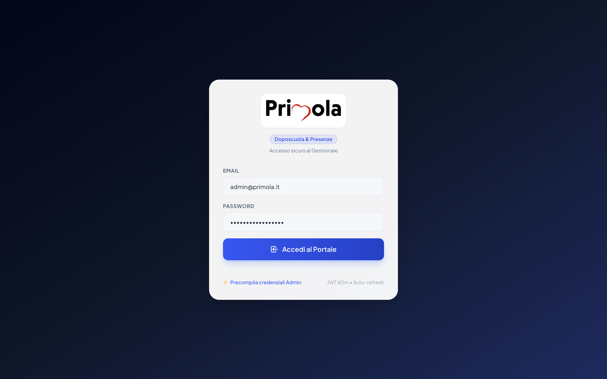

### Procedura di Autenticazione:
1. Collegarsi all'indirizzo dell'applicazione (es. `http://localhost:4200/login`).
2. Digitare **Email** e **Password**.
3. Premere **Accedi**.
4. Il sistema conserva il token di sessione in modo sicuro con meccanismo di **auto-refresh preventivo** ogni 50 minuti.

---

## 2. Registro Operativo Presenze e Rilevazione Pasti

Il registro giornaliero costituisce il punto di contatto quotidiano tra il personale di sala e la banca dati centrale.

### 2.1 Panoramica Griglia e Contatori Giornalieri

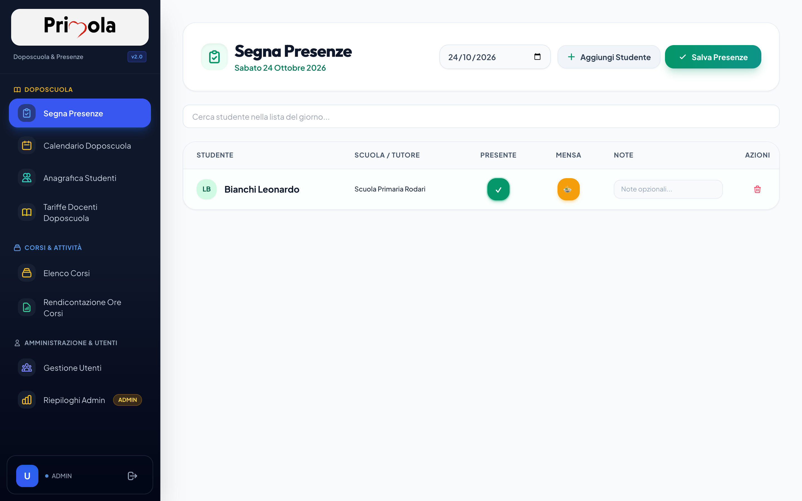

- **Selettore Data**: Consente di posizionarsi sul giorno corrente o retroattivo. Il sistema estrae automaticamente gli alunni attesi tramite `EXTRACT(ISODOW FROM date)`.
- **Barra KPI Superiore**:
  - **Attesi**: Numero totale alunni previsti dall'abbonamento settimanale.
  - **Presenti**: Numero effettivo di presenze spuntate.
  - **Assenti**: Conteggio assenze (con suddivisione immediata tra giustificate ed ingiustificate).
  - **Pasti Mensa**: Conteggio porzioni pasto da inviare al servizio mensa/catering.
- **Tasti Rapidi**:
  - `Tutti Presenti`: Accende la spunta presenza a tutti gli alunni in lista con un click.
  - `Tutti Pasti`: Accende la spunta pasto a tutti gli alunni presenti.
- **Barra di Ricerca Veloce**: Permette di filtrare istantaneamente la lista per nome/cognome/scuola durante l'ingresso scaglionato degli studenti.

---

### 2.2 Inserimento Studente Fuori Abbonamento (Extra)

Se uno studente frequenta in un giorno non compreso nel suo contratto, non compare nella lista attesi iniziale. Gli operatori abilitati possono inserirlo rapidamente:

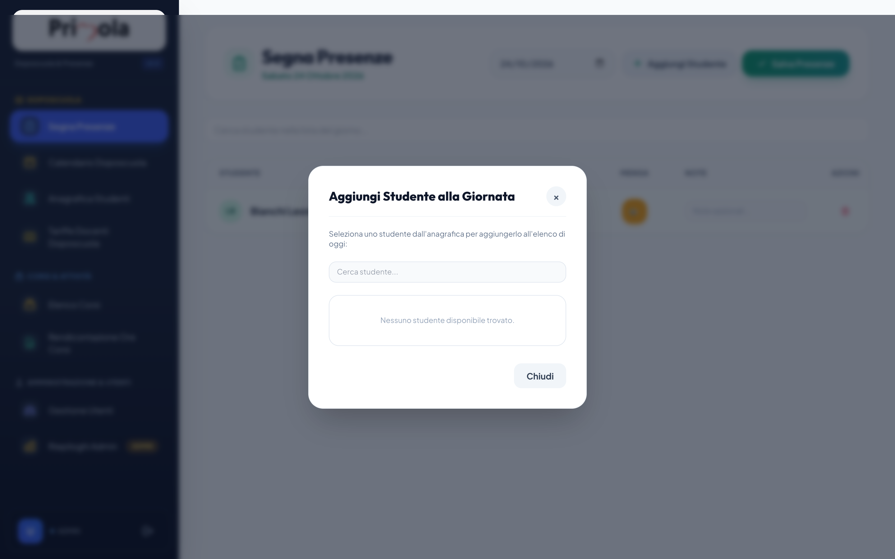

1. Cliccare sul pulsante **+ Aggiungi Studente**.
2. Cercare lo studente nella rubrica iscritti.
3. Selezionare se usufruirà o meno del pasto mensa.
4. Confermare l'inserimento: lo studente compare subito nella griglia con contrassegno **EXTRA**. Tale informazione è fondamentale per il successivo calcolo della tariffazione separata.

---

### 2.3 Regole di Compilazione e Salvataggio Massivo
- **Stato Presenza / Assenza**: Cliccando sulla cella Presenza si attiva la spunta verde.
- **Assenza Giustificata**: Spuntabile in caso di preavviso della famiglia (malattia o impegno familiare). Se non spuntata e lo studente non è presente, il sistema genera un'anomalia per la direzione.
- **Pasto Mensa**: Disaccoppiato dalla presenza (gestisce casi di diete speciali o uscite anticipate).
- **Salva Presenze**: Invia l'intero stato del giorno al server con vincolo univoco `(student_id, date)` garantendo consistenza idempotente (*bulk upsert*).

---

## 3. Gestione Anagrafica Studenti e Famiglie

Modulo per la consultazione, inserimento e configurazione dei contratti di frequenza.

### 3.1 Consultazione Rubrica e Filtri di Ricerca

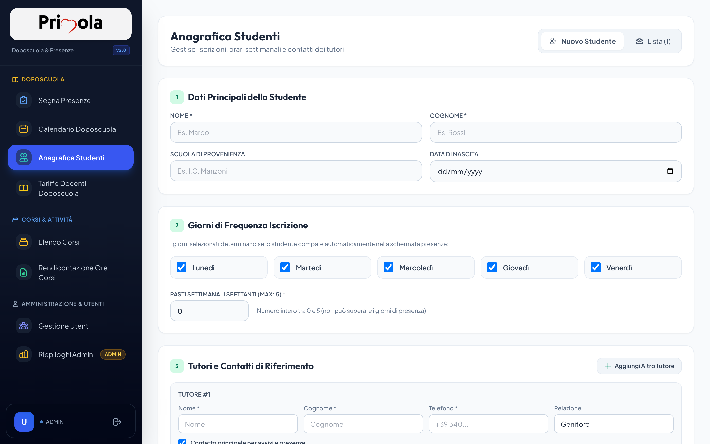

La tabella riepiloga:
- Nominativo, data di nascita e scuola di provenienza.
- Badge colorati per i giorni di abbonamento attivi (L, M, M, G, V).
- Numero pasti settimanali concordati.
- Nome e telefono del Tutore Principale di riferimento.

---

### 3.2 Creazione Nuova Scheda Studente

Campi richiesti:
- **Dati Anagrafici**: Nome, cognome, data di nascita, codice fiscale, scuola e classe.
- **Abbonamento Doposcuola**: Checkbox per ciascun giorno lavorativo (Lunedì, Martedì, Mercoledì, Giovedì, Venerdì).
- **Servizio Mensa**: Indicazione dei giorni settimanali di consumo pasto.
- **Sezione Tutori (Multi-contatto)**:
  - Possibilità di aggiungere più figure (es. Madre, Padre, Delegato al ritiro).
  - Obbligo di contrassegnare un contatto come **Tutore Principale** (`is_main = true`).

---

### 3.3 Importazione Massiva da File Excel/CSV
Per evitare l'inserimento manuale di decine di iscritti all'inizio dell'anno:
1. Scaricare il file modello [template_import_studenti.xlsx](file:///Users/dario.marchesi/Projects/personal/primola/template_import_studenti.xlsx) o CSV.
2. Compilare le colonne: dati studente, giorni doposcuola (es. `1,2,3,4,5`), giorni mensa, recapiti tutore.
3. Caricare il file tramite il pulsante **Importa Studenti** in anagrafica. Il backend valida formalmente i codici e restituisce il riepilogo delle righe importate ed eventuali scarti motivati.

---

## 4. Calendario Doposcuola, Turnazione Docenti e Chiusure

Strumento essenziale per bilanciare il rapporto educatori/bambini e visualizzare le settimane operative.

### 4.1 Vista Settimanale e Monitoraggio Carico Bambini

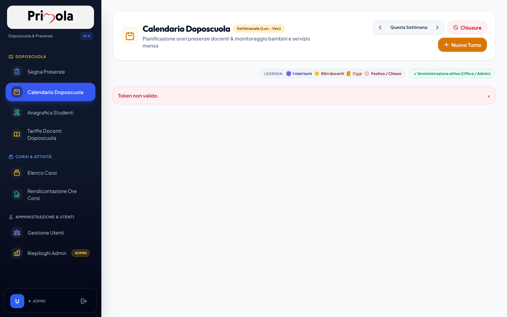

- **Colonne Giorno (Lun - Ven)**: Ciascuna colonna evidenzia la data e il numero stimato di bambini attesi calcolato sulla base degli abbonamenti attivi.
- **Card Turni Docenti**: Visualizzano il nominativo del docente, la fascia oraria coperta (es. 13:00 - 17:00) e il totale ore.
- **Differenziazione Colori**:
  - *Viola scuro*: I turni assegnati all'utente attualmente connesso.
  - *Ambra*: Turni assegnati ad altri colleghi.
  - *Rosa/Rosso*: Giorni festivi o chiusure straordinarie.

---

### 4.2 Pianificazione e Assegnazione Turno Docente

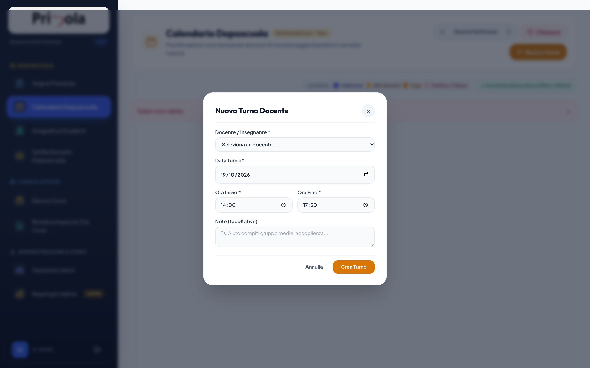

1. Cliccare su **+ Nuovo Turno**.
2. Selezionare il **Docente** dal menu a tendina.
3. Indicare la **Data** di svolgimento.
4. Specificare **Ora Inizio** e **Ora Fine** (il sistema calcola in automatico le ore decimali prestate).
5. Aggiungere eventuali note operative e premere **Salva Turno**.

---

### 4.3 Gestione Chiusure Straordinarie e Festività

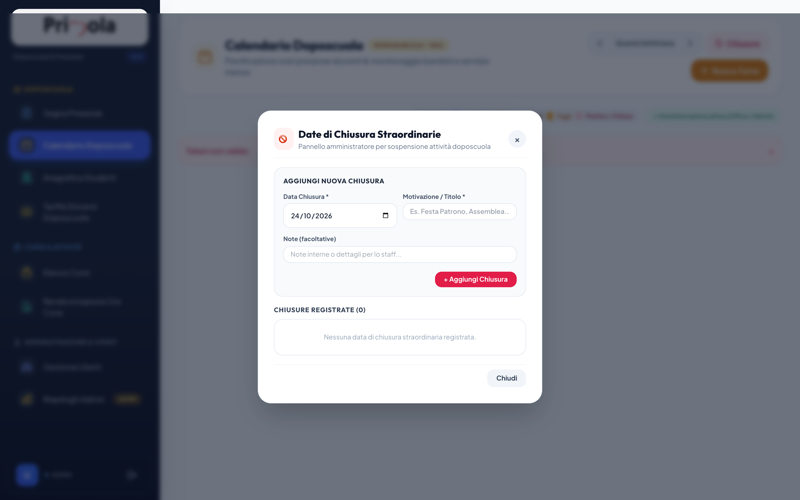

- Il sistema integra il calendario delle festività nazionali italiane (fisse e mobili come Pasqua e Lunedì dell'Angelo).
- La direzione o la segreteria possono inserire **Chiusure Straordinarie** (es. elezioni scolastiche, allerta meteo, ponte).
- L'impostazione di una chiusura azzera automaticamente gli studenti attesi per quel giorno e impedisce addebiti indebiti nel conteggio del canone mensile.

---

## 5. Gestione Corsi Extracurricolari e Commesse

Modulo dedicato ai progetti a catalogo dell'associazione (teatro, lingue, musica, aiuto compiti specialistico).

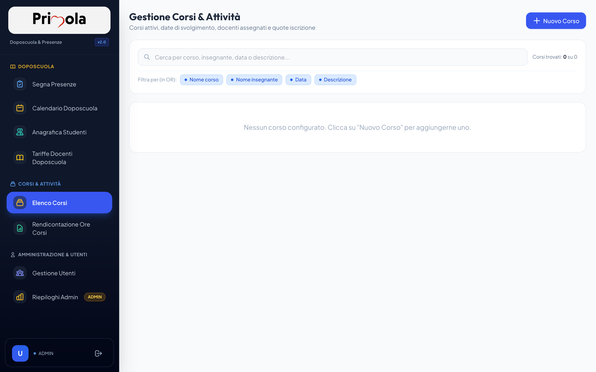

### 5.1 Apertura Corso o Commessa
- Configurazione di titolo, descrizione, luogo di erogazione e date di inizio/termine.
- Definizione della quota di iscrizione a carico della famiglia (`enrollment_fee`) e numero massimo di partecipanti.

### 5.2 Assegnazione Docenti e Riconciliazione
- Associazione di uno o più docenti con monte ore dedicato e tariffa oraria.
- Alla conclusione della commessa, il sistema calcola la marginalità lorda:
  $$\text{Ricavo Lordo} = (\text{Iscritti Effettivi} \times \text{Quota}) - \sum(\text{Ore Docente} \times \text{Tariffa Docente})$$

---

## 6. Gestione Utenti, Autorizzazioni e Compensi

Pannello di sicurezza e anagrafica collaboratori.

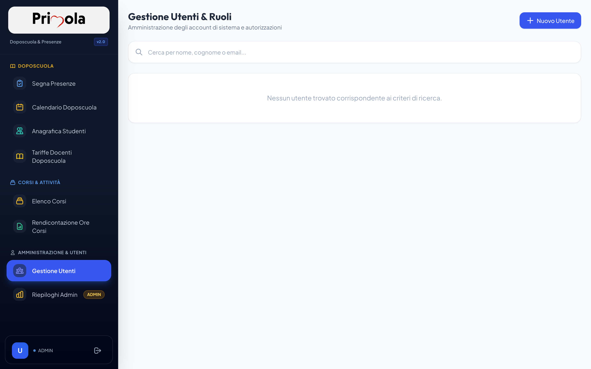

- **Elenco Personale**: Tabella con email, nome, cognome, ruoli/gruppi associati e compenso orario doposcuola.
- **Creazione / Modifica Utente**: Form dedicato per attribuire i ruoli (`TEACHER`, `OFFICE`, `ADMIN`).
- **Tariffa Oraria Personale**: Permette di definire il compenso per ciascun docente, utilizzato nei moduli di liquidazione e controllo di gestione.

---

## 7. Reportistica Operativa e Quadratura Mensa

Ambiente di controllo periodico dedicato alla segreteria e alla contabilità.

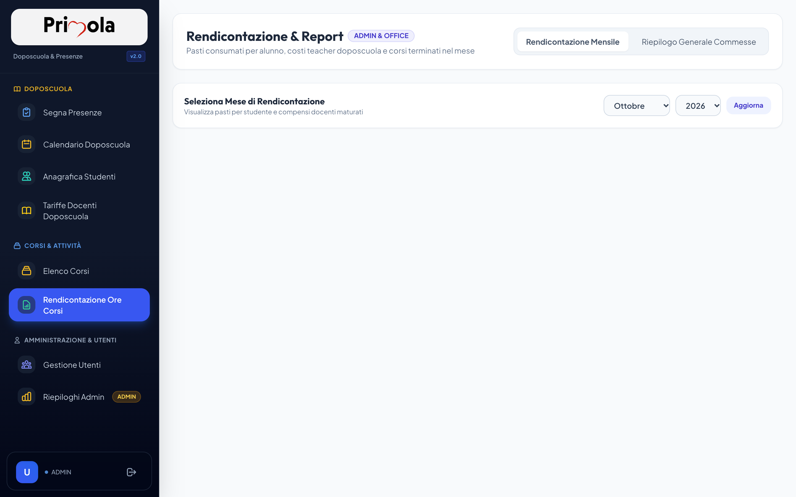

### 7.1 Rendicontazione Mensa e Fornitori Catering
- **Filtro Periodo**: Selezione da data a data (es. mese solare o quindicina).
- **Conteggi Chiave**:
  - Totale pasti erogati nel periodo.
  - Media pasti al giorno.
  - Dettaglio per singolo giorno e per singolo studente, ideale per contestare discrepanze o convalidare le fatture del fornitore esterno di ristorazione.

### 7.2 Report Operativo Mensile e Piani Pagati
- Confronto tra **Presenze Effettive** (rilevate al check-in) e **Presenze Pagate** (da piano mensile concordato).
- Evidenziazione immediata dei recuperi dovuti a favore della famiglia o dell'associazione.
- Prospetto liquidazione ore prestate dai docenti nel doposcuola e nei corsi conclusi.

---

## 8. Dashboard Amministrativa e Controllo di Gestione

Pannello direzionale per la governance della struttura.

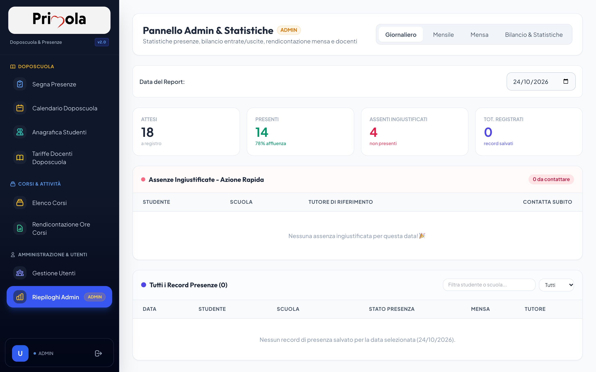

### 8.1 KPI di Presenza e Alert Assenze Ingiustificate
- Il sistema monitora in tempo reale gli alunni che risultano assenti senza alcuna giustificazione della famiglia.
- Mostra immediatamente il nome e numero del tutore principale con trigger rapido per chiamata telefonica diretta da smartphone/tablet per accertarsi della sicurezza del minore.

### 8.2 Bilancio Economico Mensile e Redditività Netta
- **Entrate Teoriche vs Incassi Effettivi**: Valutazione degli scostamenti tra abbonamenti concordati e presenze reali.
- **Margine Operativo Servizio Mensa**: Differenza tra prezzo pasto incassato dallo studente e costo sostenuto con la cucina.
- **Quadro Globale Netto**: Riepilogo di ricavi totali meno costi personale ed esterni, con indicatore di margine economico netto del mese.
